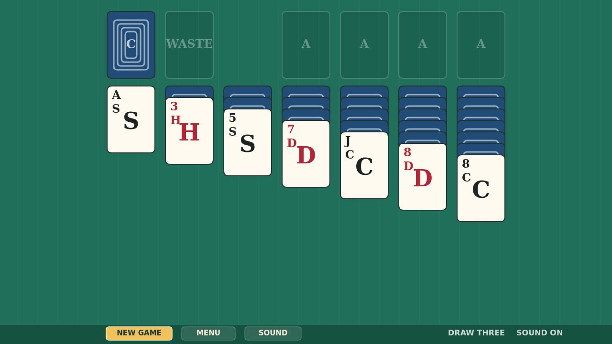
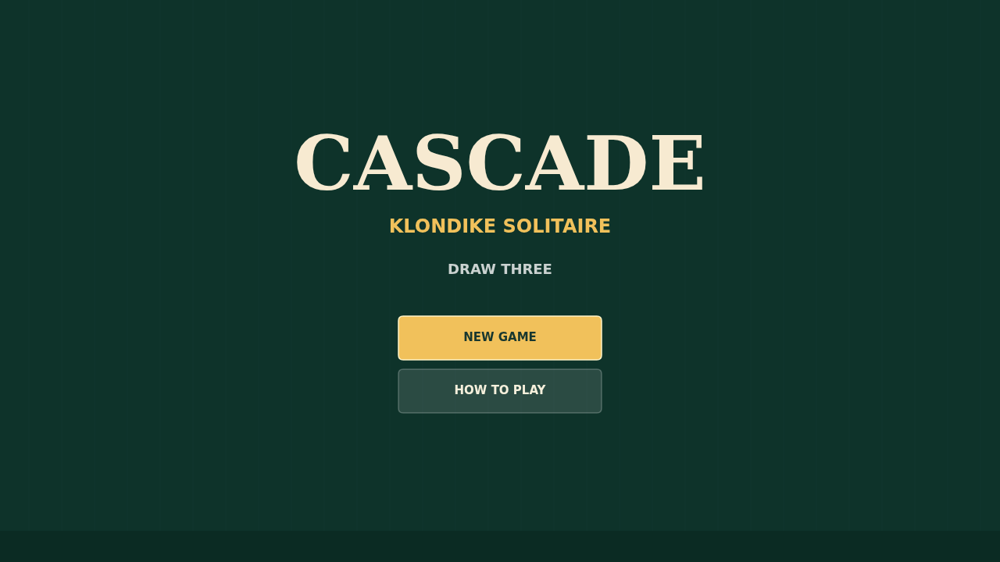

# Cascade

Cascade is a calm, readable Klondike solitaire built for the browser. It plays
Draw Three, so every stock turn fans a fresh set of cards across the waste while
only the front card is available.

Move cards by dragging them between tableau columns, foundations, and the waste.
Columns build down in alternating colors, empty columns wait for Kings, and a
double-click sends a playable card home when a foundation is ready for it.

The table keeps the focus on the cards: crisp ranks, clear suit colors, and a
compact HUD for a new deal, the menu, and sound.

When the final card lands, Cascade celebrates by launching the foundation cards
back across the felt until the table is buried in the finished deck.

